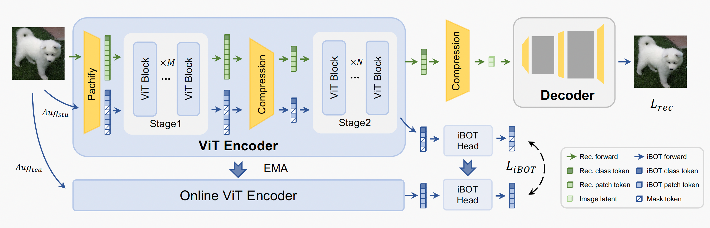

# TC-AE: Unlocking Token Capacity for Deep Compression Autoencoders

<p align="center">
    <a href="https://arxiv.org/abs/2604.07340"></a>&nbsp;
    <a href="https://huggingface.co/inclusionAI/TC-AE/tree/main"></a>
</p>
<div align="center">
  <a href="https://tliby.github.io/" target="_blank">Teng&nbsp;Li</a><sup>1,2*</sup>, 
  <a href="https://huang-ziyuan.github.io/" target="_blank">Ziyuan&nbsp;Huang</a><sup>1,*,✉</sup>, 
  <a href="https://scholar.google.com/citations?user=kwDXTpAAAAAJ&hl=en" target="_blank">Cong&nbsp;Chen</a><sup>1,3,*</sup>, 
  <a href="https://ychenl.github.io/" target="_blank">Yangfu&nbsp;Li</a><sup>1,4</sup>, 
  <a href="https://qc-ly.github.io/" target="_blank">Yuanhuiyi&nbsp;Lyu</a><sup>1,5</sup>, <br>
  <a href="#" target="_blank">Dandan&nbsp;Zheng</a><sup>1</sup>, 
  <a href="https://scholar.google.com/citations?user=Ljk2BvIAAAAJ&hl=en" target="_blank">Chunhua&nbsp;Shen</a><sup>3</sup>, 
  <a href="https://eejzhang.people.ust.hk/" target="_blank">Jun&nbsp;Zhang</a><sup>2✉</sup><br>
  <sup>1</sup>Inclusion AI, Ant Group, <sup>2</sup>HKUST, <sup>3</sup>ZJU, <sup>4</sup>ECNU, <sup>5</sup>HKUST (GZ) <br>
  <sup>*</sup>Equal contribution, ✉ Corresponding authors <br>
</div>


## News

- [2026/04/09] Research paper, code, and models are released for TC-AE!


## Introduction

<p align="center">

<p>


**TC-AE** is a novel Vision Transformer (ViT)-based tokenizer for deep image compression and visual generation. Traditional deep compression methods typically increase channel dimensions to maintain reconstruction quality at high compression ratios, but this often leads to representation collapse that degrades generative performance. TC-AE addresses this fundamental challenge from a new perspective: **optimizing the token space** — the critical bridge between pixels and latent representations. By scaling token numbers and enhancing their semantic structure, TC-AE achieves superior reconstruction and generation quality. Key Innovations:

- Token Space Optimization: First to address representation collapse through token sapce optimization
- Staged Token Compression: Decomposes token-to-latent mapping into two stages, reducing structural information loss in the bottleneck
- Semantic Enhancement: Incorporates self-supervised learning to produce more generative-friendly latents

🚀 In this codebase, we release:

- Pre-trained TC-AE tokenizer weights and evaluation code
- Diffusion model training and evaluation code

## Environment Setup

To set up the environment for TC-AE, follow these steps:

```shell
conda create -n tcae python=3.9
conda activate tcae
pip install -r requirements.txt
```

## Download Checkpoints

Download the pre-trained TC-AE weights and place them in the `results/` directory:


| Tokenizer | Compression Ratio | rFID | LPIPS | Pretrained Weights                                           |
| --------- | ----------------- | ---- | ----- | ------------------------------------------------------------ |
| TC-AE-SL  | f32d128           | 0.35 | 0.060 | [](https://huggingface.co/inclusionAI/TC-AE/tree/main) |


## Reconstruction Evaluation

##### Image Reconstruction Demo

```shell
python tcae/script/demo_recon.py \
    --img_folder /path/to/your/images \
    --output_folder /path/to/output \
    --ckpt_path results/tcae.pt \
    --config configs/TC-AE-SL.yaml \
    --rank 0
```

##### ImageNet Evaluation

Evaluate reconstruction quality on ImageNet validation set:

```shell
python tcae/script/eval_recon.py \
    --ckpt_path results/tcae.pt \
    --dataset_root /path/to/imagenet_val \
    --config configs/TC-AE-SL.yaml \
    --rank 0
```

## Generation Evaluation

Our DiT architecture and training pipeline are based on [RAE](https://github.com/bytetriper/RAE) and [VA-VAE](https://github.com/hustvl/LightningDiT).

##### Prepare ImageNet Latents for Training

Extract and cache latent representations from ImageNet training set:

```shell
accelerate launch \
    --mixed_precision bf16 \
    diffusion/script/extract_features.py \
    --data_path /path/to/imagenet_train \
    --batch_size 50 \
    --tokenizer_cfg_path configs/TC-AE-SL.yaml \
    --tokenizer_ckpt_path results/tcae.pt
```

This will cache latents to `results/cached_latents/imagenet_train_256/`.

##### Training

Train a DiT-XL model on the extracted latents:

```shell
mkdir -p results/dit
torchrun --standalone --nproc_per_node=8 \
    diffusion/script/train_dit.py \
    --config configs/DiT-XL.yaml \
    --data-path results/cached_latents/imagenet_train_256 \
    --results-dir results/dit \
    --image-size 256 \
    --precision bf16
```

##### Sampling

Generate images using the trained diffusion model:

```shell
mkdir -p results/dit/samples
torchrun --standalone --nnodes=1 --nproc_per_node=8 \
    diffusion/script/sample_ddp_dit.py \
    --config configs/DiT-XL.yaml \
    --sample-dir results/dit/samples \
    --precision bf16 \
    --label-sampling equal \
    --tokenizer_cfg_path configs/TC-AE-SL.yaml \
    --tokenizer_ckpt_path results/tcae.pt
```

##### Evaluation

Download the ImageNet reference statistics: [adm_in256_stats.npz](https://huggingface.co/jjiaweiyang/l-DeTok/commit/28ef58d254bb1bde10e331372fe542e5458f3b5f#d2h-232267) and place it in `results/`.

```shell
python diffusion/script/eval_dit.py \
    --generated_dir results/dit/samples/DiT-0100000-cfg-1.00-bs100-ODE-50-euler-bf16 \
    --reference_npz results/adm_in256_stats.npz \
    --batch-size 512 \
    --num-workers 8
```

## Acknowledgements

The codebase is built on [HieraTok](https://arxiv.org/abs/2509.23736), [RAE](https://github.com/bytetriper/RAE), [VA-VAE](https://github.com/hustvl/LightningDiT), [iBOT](https://github.com/bytedance/ibot). Thanks for their efforts!

## License

This project is licensed under the MIT License - see the [LICENSE](LICENSE) file for details.

## Citation

```
@article{li2026tcae,
  title={TC-AE: Unlocking Token Capacity for Deep Compression Autoencoders},
  author={Li, Teng and Huang, Ziyuan and Chen, Cong and Li, Yangfu and Lyu, Yuanhuiyi and Zheng, Dandan and Shen, Chunhua and Zhang, Jun},
  journal={arXiv preprint arXiv:2604.07340},
  year={2026}
}
```